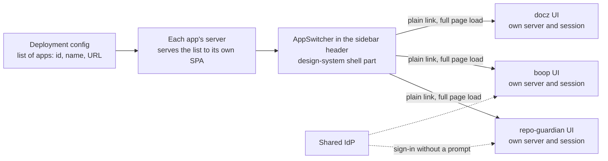

<!-- markdownlint-disable-file MD025 MD041 -->

# RFC-0002: App switcher: a shell part listing a deployment's apps as plain links

<!--toc:start-->
<!-- markdownlint-capture -->
<!-- markdownlint-disable MD013 -->
- [Summary](#summary)
- [Problem Statement](#problem-statement)
  - [Supporting Data](#supporting-data)
- [Proposed Solution](#proposed-solution)
  - [The component](#the-component)
  - [The list is configuration](#the-list-is-configuration)
  - [Icons](#icons)
  - [What it is not](#what-it-is-not)
  - [Rollout](#rollout)
  - [Resolved questions](#resolved-questions)
- [Alternatives Considered](#alternatives-considered)
  - [Keep one configured external link per app](#keep-one-configured-external-link-per-app)
  - [A portal app in front of the three](#a-portal-app-in-front-of-the-three)
  - [Each app builds its own menu](#each-app-builds-its-own-menu)
  - [A service the apps ask for the list](#a-service-the-apps-ask-for-the-list)
- [Risks and Mitigations](#risks-and-mitigations)
- [Success Criteria](#success-criteria)
- [References](#references)
<!-- markdownlint-restore -->
<!--toc:end-->

<!--docz:summary:start-->
## Summary

Add `AppSwitcher` to the shell: the sidebar header as a menu of the apps a
deployment runs (boop, repo-guardian, docz), each a plain link to another
origin. The list is configuration that each app's own server hands to its
SPA. With no list configured the header is the plain identity it is today.

<!--docz:summary:end-->

<!--docz:problem:start-->
## Problem Statement

Three apps are built, or are being built, on this package: repo-guardian,
boop and docz. A deployment that runs more than one has no way to get from
one to another except a bookmark. Each app could add its own links, and
then there are three menus that look and behave differently, which is the
duplication the package exists to remove.

The apps must also stay independent. boop does not depend on repo-guardian
(boop INV-0005), and no app calls another or shares a session. So the
switcher cannot be a portal. It has to be something each app renders on its
own from data it already has.

### Supporting Data

- `ShellSidebar` takes a `header`, documented as "the app switcher, a
  `ShellSidebarIdentity` in a menu", after shadcn's sidebar-07. The place
  exists; the component does not.
- repo-guardian puts its plain identity in that header. Its DESIGN-0039
  notes that the header "is where a portal's switcher would attach".
- boop's mockup has a working draft (`ui/web/src/candidates/AppSwitcher.tsx`
  on boop's `feat/ui-mockup` branch) built only from this package's parts:
  `DropdownMenu`, `SidebarMenuButton`, `AppMark` and `ShellSidebarIdentity`.
  It needed no new primitive. It did need one override: a menu item tints
  icons muted, which fades an `AppMark` inside it.
- The apps differ. repo-guardian and boop each have a Hono server and a
  session, and a sidebar. docz does not use the package yet, has a top bar
  and no sidebar, and leaves sign-in to docz-api.
- boop's static sketch (`ui/design/candidates.html` § 6) draws the five
  states: open, closed, not configured, collapsed to the icon rail, and a
  top-bar form for docz.

<!--docz:problem:end-->

<!--docz:proposal:start-->
## Proposed Solution



### The component

`shell/app-switcher` exports `AppSwitcher`, used as `ShellSidebar`'s
`header`:

```tsx
interface SwitcherApp {
  id: string;
  name: string;
  subtitle?: string | undefined;
  /** Left out, the entry gets a neutral mark. */
  icon?: TablerIcon | undefined;
  /** The app's origin. Unused for the current app. */
  url: string;
}

<AppSwitcher apps={apps} current="boop" home={<Link to="/" />} />
```

- With fewer than two apps it renders the plain identity as a link to
  `home`. An app that passes its own single entry looks as it does today.
- With two or more it renders the identity as a menu button. The menu
  lists every app. The current one is marked `aria-current` and labelled
  "current", and goes to `home`. The others are `<a href>` with an
  external-link icon. They open in the same tab with a full page load.
- On the collapsed icon rail the button is the mark alone, with the app's
  name as its tooltip. On mobile the menu opens below, otherwise to the
  right.
- It takes the list as props. It fetches nothing and names no app.

### The list is configuration

The package does not define where the list comes from. The convention the
apps follow:

- Each app's chart has the same value, empty by default:

  ```yaml
  ui:
    apps:
      - id: boop
        name: boop
        subtitle: renovate · fleet
        url: https://boop.example.test
      - id: repo-guardian
        name: Repo Guardian
        subtitle: compliance · read-only
        url: https://repo-guardian.example.test
  ```

- Each app's server passes it to its SPA with the rest of its UI config,
  the way repo-guardian's server passes `docs_url` through `/ui/config`.
- Each app knows its own `id` and adds its own entry if the list lacks it.
- A URL must be `https:` (or `http:` to localhost). The server checks this
  when it loads the config, because the value becomes an `href`.

### Icons

Configuration is text and cannot carry a component, so each app's code maps
the ids it knows to icons before it passes the list in. An entry with no
icon gets a neutral mark from the package. The package names no app, which
keeps RFC-0001's rule that nothing in it is shaped around one app. The cost
is a small map in each app (question 1).

### What it is not

- No shared session, token or cookie. Apps on the same IdP sign in without
  a prompt, and that is all.
- No request from one app to another, and no health or access check of the
  listed apps.
- No shared navigation, search or notifications across apps.

### Rollout

Steps 1 and 2 are done: `AppSwitcher` shipped in 0.4.0 and boop's mockup
uses it.

1. `AppSwitcher` lands in the package with stories and tests, from boop's
   draft. The menu-item icon tint is fixed in `AppMark` or `DropdownMenuItem`
   so the override goes away.
2. boop uses it when its UI is built (boop IMPL-0005 phase 11) and deletes
   the draft.
3. repo-guardian swaps its plain identity for it and adds `ui.apps`.
4. docz is out of scope here. Its move to the package is separate work,
   and what its top bar renders is decided there (question 2). Until then
   it can be listed as a destination.

### Resolved questions

Answered by Donald Gifford on 2026-11-21.

| # | Question | Answer |
| - | -------- | ------ |
| 1 | Where does an app's icon come from? | **b.** Each app's code maps ids to icons. The package names no app and gives an entry with no icon a neutral mark. Three small maps are the accepted cost. A map in the package (a) and an image URL in config (c) were rejected. |
| 2 | What does docz, with a top bar and no sidebar, render? | Not decided here. docz's migration to the package is separate work and settles it. This RFC builds the sidebar form only. |
| 3 | Is an entry shown to a user with no access to that app? | **a.** Yes. The list is deployment configuration, the same for everyone. The destination app refuses or signs the user in. No app asks another about access. |
| 4 | Does a link to another app open in the same tab? | **a.** Yes. The entries are real links, so a modifier click opens a new tab. |
| 5 | Who adds the current app's entry when the list lacks it? | **a.** The app's server adds it from its own id and name, so a deployer can list only the other apps. |

<!--docz:proposal:end-->

<!--docz:alternatives:start-->
## Alternatives Considered

### Keep one configured external link per app

boop starts here (boop INV-0005 OQ4 b): one nav entry from `ui.links`. It
needs nothing from the package. It does not scale to three apps that should
look alike, and the link sits among the app's own pages rather than where
the shell says the switcher goes.

### A portal app in front of the three

One app that owns sign-in and frames or proxies the others. It makes every
app depend on the portal and on a shared session, which boop INV-0005 and
repo-guardian's design both rule out.

### Each app builds its own menu

No package work. Three menus drift, which is the problem RFC-0001 set out
to end.

### A service the apps ask for the list

A registry the apps query at run time. It adds a service and a failure
mode to render a list of at most a few static links.

<!--docz:alternatives:end-->

<!--docz:risks:start-->
## Risks and Mitigations

| Risk | Impact | Likelihood | Mitigation |
| ---- | ------ | ---------- | ---------- |
| The lists drift between apps in one deployment | A link is missing from one app | Medium | One documented value shape; a deployment sets the same list in each chart |
| A configured URL is unsafe as an `href` | Script injection through config | Low | Each server accepts only `https:` (and `http:` to localhost) at load |
| The apps' icon maps drift | An app shows a different mark in different apps | Low | Three ids; an unknown id gets the package's neutral mark, not a broken one |
| docz needs a form this component lacks | A second switcher that looks different | Medium | Only the sidebar form is built now; docz's migration adds a bar form here if it needs one |
| Users read the switcher as single sign-on | Surprise at a second sign-in | Low | Document that sessions are separate; a shared IdP removes the prompt |

<!--docz:risks:end-->

<!--docz:criteria:start-->
## Success Criteria

- `AppSwitcher` is in a release with stories for each state (one app, a
  menu, the icon rail, mobile) and tests for the links, `aria-current`,
  keyboard use and axe.
- boop and repo-guardian render the same switcher from the same value
  shape, and boop's draft is deleted.
- With `ui.apps` empty, each app's header is unchanged from today.
- No app imports, calls or shares a session with another.

<!--docz:criteria:end-->

<!--docz:references:start-->
## References

- [RFC-0001](0001-shared-design-system-and-component-library-for-repo-guardian.md):
  the package, its layers and how a component gets in.
- boop INV-0005, finding 9 and OQ4/OQ8: the switcher as a list of plain
  links, designed in this repository.
  <https://github.com/donaldgifford/boop/blob/main/docs/investigation/0005-boop-ui-its-own-app-on-the-design-system-or-a-backend-of-repo.md>
- boop's draft and sketch: `ui/web/src/candidates/AppSwitcher.tsx` and
  `ui/design/candidates.html` § 6 on the `feat/ui-mockup` branch of
  <https://github.com/donaldgifford/boop>.
- shadcn sidebar-07, the team switcher the shell's header follows:
  <https://ui.shadcn.com/blocks/sidebar#sidebar-07>

<!--docz:references:end-->
